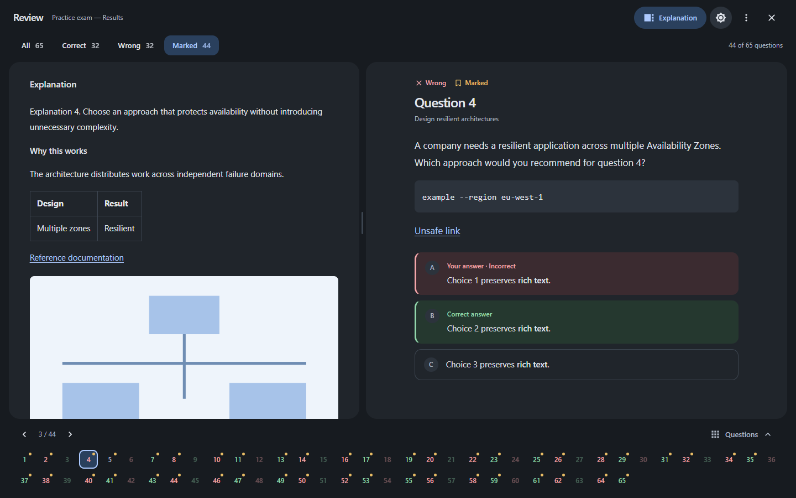
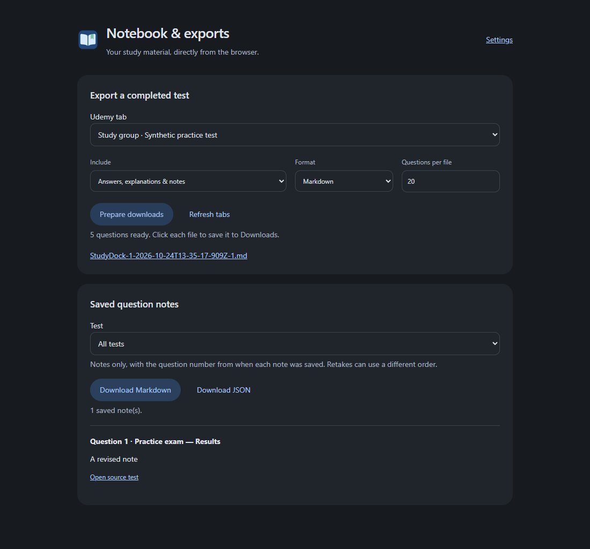

# StudyDock

A Chrome extension for Udemy practice exams, question notes and focused review, with an optional desktop exporter. Read one question at a time, inspect explanations and diagrams, and export Markdown or JSON batches for study notes.



## What it does

- **Focused review:** one question, a separate resizable explanation pane, All / Correct / Wrong / Marked filters, and a collapsible question-number tray.
- **Diagrams:** open images, zoom, pan, fit, and close without losing your place.
- **Consistent appearance:** light/dark themes, Material icons, comfortable reading widths, and short transitions that respect reduced-motion preferences.
- **Native Udemy dark mode:** themes neutral surfaces and text on the original page, including hard-coded white cards. Colored charts and media retain their original colors.
- **Exam controls:** full-height view, optional pause-overlay removal, and optional auto-resume.
- **Question notes:** write beside an exam question or in focused review. Notes save locally in Chrome and join matching questions in exports.
- **Browser exports:** export completed tests or just your notes without running the desktop app. Choose Markdown/JSON and question batches of 5 or more, or All; default 20.
- **Settings:** hide desktop integration and the extra full-height shortcut, enable/disable notes, and choose appearance and exam behavior. Creator/source links live here.
- **Optional desktop exports:** select multiple Chrome tabs and save batches directly to your chosen folder.

Review, notes and browser downloads need only the extension. Reviewing/exporting never answers questions, changes review marks, or submits/retakes a test. Auto-resume is a separate opt-in setting that operates Udemy's Resume control.

## Install

Download the matching package from [Releases](https://github.com/HimanM/Udemy-Study-Tools/releases). This repository is private: sign in with an account that has access. Packaged desktop apps include Python and Tk; you do not need to install Python separately.

Release assets contain only the desktop application packages. The browser extension stays in this repository; there is no separate extension ZIP or checksum text-file download.

| System | Package | Installation |
| --- | --- | --- |
| Windows 10/11, x64 | `windows-x64-setup.exe` | Run the installer. It installs for your account and adds Start-menu and desktop shortcuts. A portable ZIP is also available. |
| macOS 14+, Apple Silicon | `macos-arm64.dmg` | Open the disk image and drag the app to Applications. |
| macOS 15+, Intel | `macos-x64.dmg` | Open the disk image and drag the app to Applications. |
| Linux x64, glibc 2.35+ | `linux-x64.bin` | One executable with Python/Tk bundled. Run directly, or use `--install` to create application-menu and desktop entries with the icon. No sudo needed. |

Linux builds target Ubuntu 22.04 or newer and compatible glibc desktop distributions. No Python, pip, virtual environment, FUSE, or separate app runtime installation is needed. A graphical desktop with its usual X11/XWayland system libraries is required. A single binary cannot cover incompatible CPU/libc families: Alpine/musl, older glibc, and Linux ARM are not covered. See [PyInstaller's Linux compatibility explanation](https://pyinstaller.org/en/stable/usage.html#making-gnu-linux-apps-forward-compatible).

Download the [Linux binary](https://github.com/HimanM/Udemy-Study-Tools/releases/download/v1.4.3/StudyDock-1.4.3-linux-x64.bin) while signed into GitHub, then run from that download directory:

```sh
chmod +x StudyDock-1.4.3-linux-x64.bin
./StudyDock-1.4.3-linux-x64.bin --install
```

Omit `--install` to run it without installation. The installed binary and icon go under your user data directory. The Chrome setup button copies the bundled extension to a permanent folder, so Chrome never depends on a temporary unpacking directory. Some desktops require **Allow Launching** on a new desktop icon, or disable desktop icons entirely; the application-menu entry remains available. As a private GitHub release, this is not an anonymous `curl | sh` URL.

The Windows and macOS packages are **unsigned**; no publisher certificate or Apple notarization credentials are configured. Windows may show SmartScreen, and macOS may require approval in System Settings → Privacy & Security after an attempted launch. Only open packages from this repository that you trust. GitHub provides [SHA-256 digests for release assets](https://docs.github.com/en/rest/releases/assets); the optional installer verifies its download against that digest.

### Optional Python installer

If Python 3.9+ is already available, download [install.py](install.py) using GitHub's **Download raw file** button, then run:

```sh
python3 install.py
```

On Windows, use `py install.py`. No pip packages are needed. The script downloads the latest packaged app for your OS/CPU, verifies its SHA-256 digest, and installs it. Linux gets the app-menu and desktop shortcuts; Windows opens the normal setup wizard; macOS installs to `~/Applications/StudyDock.app`. Close StudyDock before upgrading.

Since the repository is private, the script reads `GH_TOKEN` or `GITHUB_TOKEN`, or asks for a token in a hidden terminal prompt. Use a token with read-only **Contents** access to this repository. The token is not saved or passed to the downloaded installer. Browser downloads do not require a token. Python is needed only to run this optional installer; the installed app runs independently.

### Chrome companion

1. Use the desktop app's **Chrome setup** button to find the bundled extension, or download this repository with **Code → Download ZIP** and extract it into a permanent folder.
2. Open `chrome://extensions`, enable **Developer mode**, and select **Load unpacked**.
3. Choose the `extension` folder. Pin **StudyDock** from Chrome's Extensions menu.
4. Open a completed test attempt in Udemy and select **Review questions**.

The extension is installed locally; it is not published to the Chrome Web Store. Your existing Udemy login stays in Chrome. The desktop app's **Chrome setup** button can also show/copy the bundled extension path.

The [static product website](website/README.md) includes a working study demo, OS-aware desktop downloads and the [privacy policy](docs/PRIVACY.md). Public hosting has not been enabled. Chrome Web Store submission materials are maintained locally and are intentionally excluded from this repository.

## Review controls

| Control | Action |
| --- | --- |
| All / Correct / Wrong / Marked | Filter questions; previous/next follows the filter. |
| Question numbers | Green = correct, red = wrong, amber dot = marked. A number outside the filter returns to All. Status also has accessible text labels. |
| Questions | Show/hide the tray; preference is saved. |
| Explanation | Show/hide the explanation. On narrow screens it replaces the question pane. |
| Divider | Drag to resize; keyboard arrows and Home/End work when focused. |
| More menu | Move explanation left/right and read keyboard help. |
| Appearance icon | Toggle the saved extension theme; first use follows the system. |
| Close / Original view | Return to Udemy's original layout. Focus review reopens the workspace. |
| Image | Click or press Enter/Space to open the viewer. Wheel or +/− zooms, drag/arrows pan, and Fit/0 recenters. |

**Shortcuts:** Left/Right navigate; E toggles the explanation; Escape closes an image or menu first, then returns to the original page. Shortcuts avoid editable fields and the resizing control. Layout, theme, tray visibility, and the last question of the most recently reviewed attempt are saved locally. Question content is not saved by the review workspace.

Disable Dark Reader on Udemy when using this tool's dark theme so the two extensions do not compete. The native theme adapts neutral backgrounds/text; a future Udemy layout change may need adjustments.

### During an exam

These switches are **off by default** and independent of focused review:

- **Full-height view:** removes Udemy's height limit while retaining the footer controls.
- **Hide pause screen:** removes the blur and large paused panel, leaving a small Resume control. The timer remains paused.
- **Keep exam running:** automatically resumes every pause, including manual pauses. The timer continues running. Disable this to pause normally. Browser suspension and sleeping computers can delay it.

Keep-running takes precedence over hiding the pause screen. If you use the original Fuck-Udemy-Exam-UI Tampermonkey script, disable its overlapping controls while using the extension's equivalents.

## Export for study

### In the browser

Open StudyDock → **Notebook & browser exports**. Select a completed-results tab, detail level, file format and batch size. **Prepare downloads** reads the test and creates download links for each part. Click each file to save it through Chrome. No desktop process or polling connection is needed.



The lower half of this page lists saved notes. Filter by test and download notes-only Markdown or JSON with question numbers and source links. Notes-only downloads do not include question text or answer keys.

### Question notes

Choose **View → Right panel** inside Notes, or set **Notes view** in Settings, to dock the editor. Exams keep the question and Notes side by side; Udemy's course/AI sidebar is temporarily hidden. In focused review, Notes replaces Explanation until you switch back. Close or minimize Notes to restore the previous workspace. **Floating window** remains available, and screens narrower than 1100 px use it automatically. Your choice is saved and switching layouts keeps your draft. Where Udemy exposes its Mark for review button, Notes sits beside it; marking still uses Udemy's own control.

Click **Notes** beside a question on Udemy, or in focused review's top bar. Notes save as you type; the panel reports save failures and offers a retry. Use **Minimize notes** to keep a compact question/status bar, or **Expand notes** to return to the larger, resizable writing area. In exams and focused review, notes follow the selected question even when minimized, after saving the previous draft. Question numbers are read automatically from Udemy and cannot be edited. If a layout's counter cannot be identified, the panel says the number is unavailable instead of guessing; the note remains attached to the question's content. If saving fails, the editor keeps that draft and its question label until you retry. Close it with Close or Escape.

Notes match normalized prompt text, question-image paths and available answer-choice text within the same quiz. Numbers and answer order do not identify a question. Notes therefore follow matching questions across attempts; changed question content or an unrecognized author/layout may prevent a match. Notes-only question numbers reflect the last saved source attempt. In full-test exports, notes appear under the current question number.

Notes live in this Chrome profile's extension storage, not in Udemy or the desktop app. Export a backup before uninstalling the extension or clearing its data. Disabling Question notes only hides the editor. To clear a note, erase its text; it will no longer appear in notes-only downloads. Each note supports up to 60,000 characters, subject to Chrome's total local-storage quota. Simultaneous edits to the same note in multiple tabs use the last saved version; the editor warns when another tab changes it.

### With the desktop app

1. Launch the desktop app.
2. Click the extension → **Connect desktop exporter**, and leave the connection tab open. Enable Desktop integration in Settings if this button is hidden.
3. In the app, select one or more completed-results tabs. Search by tab group, title, or URL; Ctrl/Cmd or Shift selects multiple tabs.
4. Choose detail level, Markdown or JSON, questions per file, and an output folder.
5. Click **Export selected tabs**. Open the output folder when finished.

| Detail level | Includes |
| --- | --- |
| Questions & your answers | Question, all options, selected answers, review flag/tag, domain, your notes |
| Full detail | Everything above, plus correct answers, result tags, overall explanation, and per-choice explanations |

Correct answers come from **Udemy's labels**, never guesses based on the author's explanation order. Full explanations preserve rich text, links, tables, code and image URLs. Authors can explain correct and incorrect choices in any order. Multi-select answers remain arrays in JSON. Skipped questions are included with empty selections.

Desktop exports create a new folder per tab/attempt; browser exports create separately named downloads. Files include source URL, attempt, timestamp, and part number. For example, 88 questions split into 20 gives 20 + 20 + 20 + 20 + 8. Basic mode excludes Udemy's answer-key fields and result tags, but includes your own notes as written. Marked questions include `marked_for_review: true` and a matching tag. Question notes use `notes: {text, updated_at}` in JSON and a Your notes section in Markdown.

Images are referenced by URL, not downloaded or transcribed. URLs can require Udemy access or expire. When asking an LLM about a diagram, attach the diagram as well as the exported text.

### Local data

The app writes to your user data directory, not its installation folder:

| System | Default directory |
| --- | --- |
| Windows | `%LOCALAPPDATA%\UdemyStudyTools` |
| macOS | `~/Library/Application Support/UdemyStudyTools` |
| Linux | `${XDG_DATA_HOME:-~/.local/share}/udemy-study-tools` |

Exports default to the `exports` subfolder; you can choose another folder. The desktop theme is stored in `preferences.json` and is independent of Chrome's saved theme. Existing source-folder exports are left in place when upgrading. Closing during an export asks before discarding pending jobs.

## Update or uninstall

Close the app before upgrading. Install the new desktop package over the old one. On Linux, run the new binary with `--install` again. Replace files in the extension's permanent folder, reload it at `chrome://extensions`, and refresh open Udemy tabs. Keep the extension path unchanged to retain its settings and notes. Renaming the product to StudyDock does not move existing desktop export directories.

Uninstall Windows through Installed apps; remove the app from Applications on macOS. On Linux, remove the `app` subfolder from the data directory and `com.himanm.UdemyStudyTools.desktop` from your desktop and `~/.local/share/applications` (or the corresponding XDG location). Your export folders and preferences are kept separately; delete those only if you intend to remove your study data.

## Troubleshooting and limits

- **Waiting for the desktop app:** launch it and keep the Chrome connection tab open. The connector uses `127.0.0.1:8765`; only one app instance can use that port.
- **No tabs:** clear the search and confirm the extension is installed in the Chrome profile containing the tests.
- **Chrome denies access:** open and refresh that results tab, allow the extension access to Udemy, and retry.
- **Missing/count mismatch:** open the desired completed attempt, wait for Review questions to load, select All domains / All questions, and retry. Exports fail rather than silently save an incomplete test.
- **Unknown layout:** current parsing targets English-language completed Udemy practice tests. The original page remains available when the review parser cannot recognize the layout.
- **New install/update:** refresh already-open Udemy tabs after loading/reloading the extension.

## Privacy

No analytics, external AI service, passwords, or cookies are sent by this tool. The extension reads the Udemy pages it needs, tab-group names, and its own settings. Notes and a short question preview stay in extension storage. Browser exports download locally. The optional desktop connection sends exports to a loopback-only connector using extension-origin checks and a per-session token. This blocks ordinary web-page access; it is not a security boundary against other programs already running on your computer. Exported files contain course questions, your answers, notes, and source URLs—keep them private as appropriate.

## Run from source

Use Python 3.10+ with Tkinter and Chrome. No third-party Python packages are required at runtime:

```sh
python extractor.py
```

On Windows, `Start Extractor.bat` also works. Debian/Ubuntu source installs may need `python3-tk`; macOS needs a Python build with Tk support. Load `extension/` in Chrome as described above.

## Development and releases

Python 3.12 is used in CI. Developer packages are pinned in `requirements-dev.txt`:

```sh
python -m pip install -r requirements-dev.txt
python -m playwright install chrome
python test_extractor.py
python test_review.py
python test_notebook.py
python test_install.py
```

Linux headless checks need `xvfb-run -a python test_extractor.py`. Pass `--screenshots` to the review or notebook tests to write synthetic previews under `.dev-previews/`. Tests cover exports/authentication, desktop preferences/platform paths, review navigation, image viewer, native-theme contrast/restoration, notes and save failures, browser downloads, settings, connection states, and mobile/reduced-motion behavior. Screenshots contain synthetic fixtures, not personal exports.

- **Checks workflow:** tests Windows, Linux, macOS Apple Silicon, and macOS Intel on pushes/PRs.
- **Release workflow:** on a `v*` tag, runs the checks, verifies the tag matches `extension/manifest.json`, builds on each target OS, smoke-tests the bundles, validates Linux installation/launchers and the Windows installer, then publishes only desktop packages if every job succeeds. GitHub supplies the asset SHA-256 digests.
- **Manual release workflow:** builds test artifacts without publishing a release when run from a branch.
- **Local build:** `python tools/build_release.py` on the target OS. Windows needs Inno Setup 6; macOS uses `hdiutil`; Linux needs a display or Xvfb. PyInstaller does not cross-compile.

To release, update the manifest version and `RELEASE_NOTES.md`, commit, then push the matching version tag. There is no automatic desktop/extension updater; install released updates manually. Signing/notarization is not configured.

## Credits and license

MIT, copyright 2026 HimanM. Full-height behavior derives from [Fuck-Udemy-Exam-UI](https://github.com/HimanM/Fuck-Udemy-Exam-UI); its MIT notice remains in `extension/LICENSE-fullheight.txt`. Google [Material Design Icons](https://github.com/google/material-design-icons) are bundled under Apache 2.0, with the license in `extension/icons/LICENSE-material-icons.txt`. This tool is not affiliated with Udemy.

The StudyDock app icon was created with the built-in image-generation tool. Its source artwork and generation prompt are documented in [Brand artwork](docs/brand.md).
